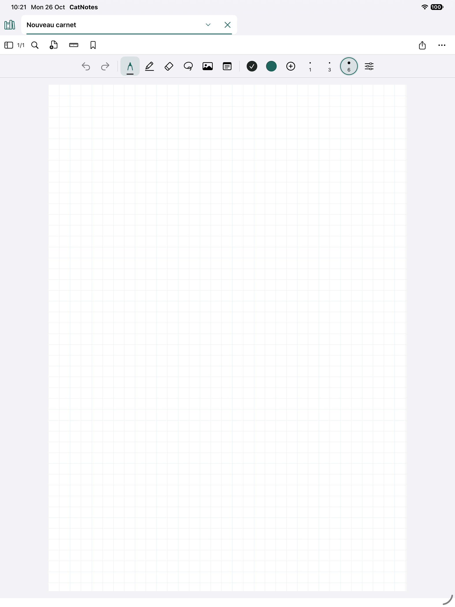
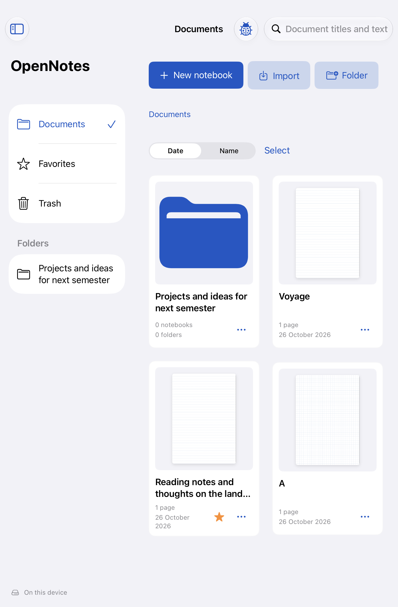
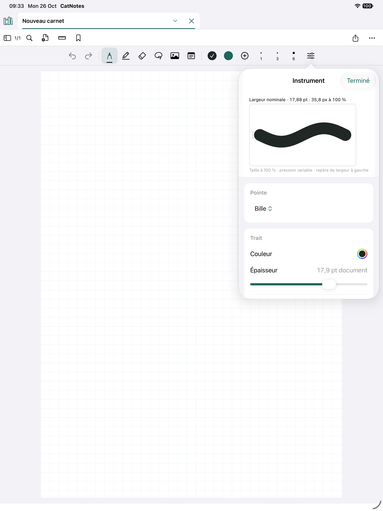

# OpenNotes


### A friendly place for your ideas.

A native, open-source notebook for iPad and iPhone, built with SwiftUI, UIKit, Core Graphics and PDFKit. Write by hand, annotate PDFs and keep your notebooks on your device. No account or external package is needed for local use.

**Current source · 0.1.0 / build 10 · iOS & iPadOS 16+**

The published download below remains the older build 9 prototype.

[Explore the website](https://edouaz.github.io/OpenNotes/) · [Download the IPA](https://github.com/edouaz/OpenNotes/releases/download/v0.1.0-prototype.9/OpenNotes-ios16-build9-unsigned.ipa) · [Installation & development](https://edouaz.github.io/OpenNotes/develop.html) · [Contribute](CONTRIBUTING.md)



## Current source experience

The app has a simple notebook library and tabs for keeping several notebooks open. Open notebooks and the active tab are restored on launch.

- Apple Pencil writing with pen, highlighter, eraser and lasso, plus undo and redo.
- Tap the selected tool for color, width, ballpoint/fountain/brush profiles, stabilization, sharpness and solid/dashed/dotted patterns on iPadOS 16+.
- Move selected ink and attachments with a live preview. Whole-stroke erasing shows a tip cursor, including Pencil hover on supported iPads.
- Add pages directly; browse and reorder pages from the page counter.
- Paper templates, search, PDF export and native `.catnote` backups in the notebook menu.
- PDF import, folders, favorites and recoverable Trash in the library menu.
- Existing notebook ink and attachments remain compatible. Local storage, autosave and explicit save errors are retained.

Writing now uses the application's native ink engine. Raw Pencil samples, frozen styles and editable geometry are saved in versioned JSON. Predicted input and hover remain temporary. Partial erasing creates independent editable fragments; draw-and-hold and circle-then-long-press use the existing editor selection and undo system.

**Build 10 changes the ink format. Old PencilKit pages are unsupported and produce an explicit error.** Create a new notebook for this build. No automatic conversion or deletion is performed. See [migration audit](MIGRATION_AUDIT.md) and [validation report](docs/INK_VALIDATION.md).
The downloadable build and screenshots below describe the older build 9 interface, not this source cleanup.

| Your library | Tune your pen |
| --- | --- |
|  |  |

Screenshots are real simulator captures. All images show the OpenNotes build 9 interface. [Capture provenance](docs/SCREENSHOTS.md).

## Install the prototype

[Download build 9](https://github.com/edouaz/OpenNotes/releases/download/v0.1.0-prototype.9/OpenNotes-ios16-build9-unsigned.ipa). **The IPA is unsigned**: opening it on an iPhone or iPad does not install it. Sign it using your own provisioning setup, or run the source in Xcode. The app and share extension need matching App Group entitlements. See the [installation guide](https://edouaz.github.io/OpenNotes/develop.html#install).

OpenNotes keeps the existing bundle identifiers, App Group, Keychain service and local data directory so an update can access earlier notes. Sign with the same team and identifiers and export a native backup before upgrading. Do not uninstall first. [Compatibility details](docs/ARCHITECTURE.md#rebrand-compatibility-identifiers).

This is an early prototype, far from a final release. Export backups before using valuable notes. Physical Apple Pencil performance, older iPad hardware, accessibility and cloud synchronization are not fully validated. Supabase is experimental and optional; local use works without it.

## Run from source

You need macOS, Xcode with an iOS simulator runtime, and Python 3 only when regenerating the project. No CocoaPods, Swift packages or backend setup.

```sh
git clone https://github.com/edouaz/OpenNotes.git
cd OpenNotes
open OpenNotes.xcodeproj
```

Select the **OpenNotes** scheme and an installed iPad or iPhone simulator, then Run. On hardware, select your signing team for both targets and configure matching bundle identifiers and App Groups. [Full developer guide](https://edouaz.github.io/OpenNotes/develop.html#development).

```sh
# After adding/removing Swift files; the project generator is the source of truth.
python3 scripts/generate-project.py

# Replace the destination with a simulator listed by xcodebuild -showdestinations.
xcodebuild -project OpenNotes.xcodeproj -scheme OpenNotes \
  -destination 'platform=iOS Simulator,name=iPad Pro 13-inch (M5)' \
  -derivedDataPath build CODE_SIGNING_ALLOWED=NO test
```

## Find your way around

| Path | Responsibility |
| --- | --- |
| `OpenNotes/App/` | Library, workspace and shared visual style |
| `OpenNotes/Core/` | Codable models, paper and tool settings |
| `OpenNotes/Editor/` | Native ink capture, geometry, rendering, gestures and editing |
| `OpenNotes/Services/` | Persistence, PDF indexing, diagnostics and optional sync |
| `Shared/`, `ShareExtension/` | App Group inbox and iOS share extension |
| `OpenNotesTests/`, `OpenNotesUITests/` | Domain, storage, rendering and interaction tests |
| `Config/`, `scripts/` | Plists, entitlements, project generator and packaging |
| `docs/` | GitHub Pages, architecture and release information |

[Architecture & data](docs/ARCHITECTURE.md) · [Prototype release notes](docs/RELEASE.md) · [Security reporting](SECURITY.md) · [Third-party notices](THIRD_PARTY_NOTICES.md)

## License

MIT. Portions derived from [Signotes](https://github.com/SignoCreator/signotes) retain their original MIT notice. See [LICENSE](LICENSE) and [third-party notices](THIRD_PARTY_NOTICES.md).
