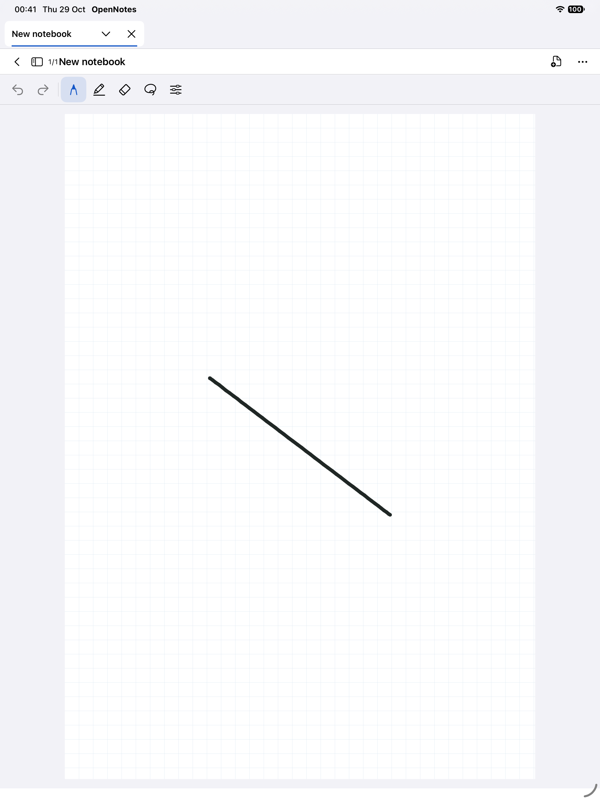
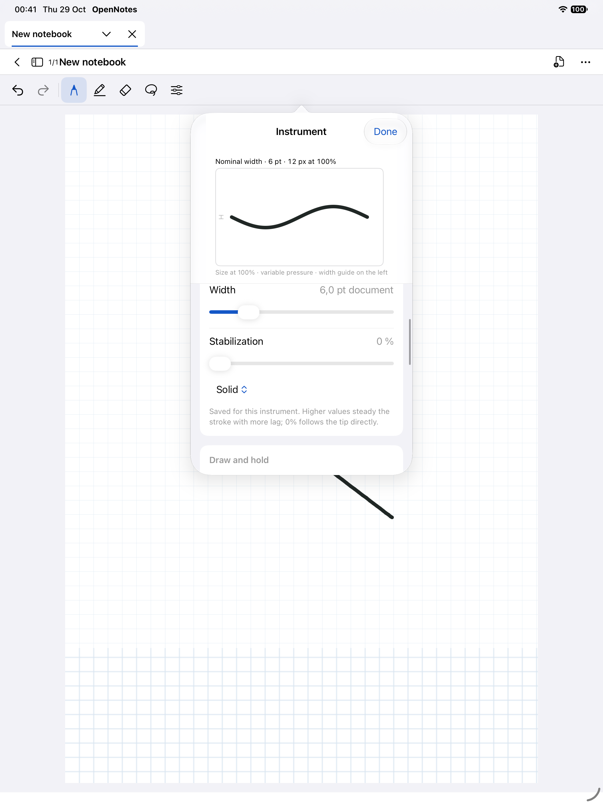

# Native ink build 10 — validation

Target: iOS/iPadOS 16.0+. Xcode 27.1. Simulator runtime iOS 27.0.
Scope: the 16 behaviors in the supplied migration specification. Legacy conversion explicitly waived by the user; no automatic note deletion. Old PencilKit ink cannot be opened by this build.

## Automated coverage and physical-device checklist

| ID | Automated evidence | Manual iPad check still required |
|---|---|---|
| PEN-01 | Ball diameter constant, including raw pressure changes | Light/heavy Pencil force, reload |
| PEN-02 | Progressive Fountain profile, saved style | Slow/fast pressure ramp |
| PEN-03 | Wider Brush response | Expressive curves and sharp turns |
| PEN-04 | Frozen sharpness, point/short-stroke geometry | Hooks, dots, 0–100% cap appearance |
| PEN-05 | Causal prefix stability, synthetic jitter reduction | Latency and small writing at zoom |
| PEN-06 | Arc-length dot/dash sampling-density invariance | Patterns on tight curves at different speeds |
| PEN-07 | Color/style unchanged on old ink and reload | Blue then red with Pencil |
| GEST-01 | Dense overlapping scribble vs negative handwriting fixtures | Repeated ratures on words, false positives |
| GEST-02 | Editable fragments, separate dot preserved, exact undo | Partially cross out handwriting and dot of i |
| GEST-03 | Circle stays stored, contour eligibility, expiry | Draw circle, lift, long press its contour, move selection |
| GEST-04 | Line/ellipse/polygon/curve recognition; held geometry routed | Hold Pencil still for 550 ms |
| GEST-05 | Anchored scaling/rotation; geometry/raw separation | Adjust while still pressed, lift without jump |
| INPUT-01 | Pencil-only rejects direct input, cancel ignores unrelated contacts | Palm resting + Pencil + two-finger navigation |
| INPUT-02 | Ephemeral overlay by construction; guarded system hover preference | Compatible Pencil hover and older iPad fallback |
| DOC-01 | Exact snapshots through erase/shape undo+redo; real finger UI test | Interrupt gestures and repeat editing history |
| DOC-02 | Exact JSON/IDs/raw/style/PNG after new-session reopen | Close/relaunch after real writing |

All physical-device checks above are **NOT RUN**. No Goodnotes parity, FPS, pressure calibration or physical Pencil latency is claimed.

## Known limits

- Pressure, stabilization, gesture thresholds and 550 ms hold duration are initial calibration, not measured Goodnotes values.
- Partial erasing splits longitudinal paths where the eraser touches the painted envelope. It removes the affected cross-section; it does not retain lateral fringes of a thick stroke. Pattern/taper geometry is baked into editable solid fragments after a cut.
- Very long scribbles with over 2048 simplified vertices stay ordinary ink, preserving classifier cost and avoiding accidental deletion.
- Committed geometry is cached in retained vector layers. 1k/10k synthetic serialization/render diagnostics do not establish live Pencil latency or older-device memory use.
- iOS 16 API compilation is checked by the deployment target; actual iPadOS 16 execution needs hardware/runtime unavailable here.

## Execution log

Final source: `06354375bc36145d5c56a9e51f6f4501bd42f49f`.

- **PASS:** 150 XCTest cases, 0 failures, plus 7 Swift Testing tests in 2 suites. Final result bundle: `build/native-ink/Logs/Test/Test-OpenNotes-2026.10.29_09-52-13-+0100.xcresult`.
- **PASS:** actual finger draw → Undo → Redo → scroll pen options → return to library → terminate/relaunch → reopen same notebook, with screenshots. UI result bundle: `build/native-ink/Logs/Test/Test-OpenNotes-2026.10.29_00-39-16-+0100.xcresult`. This solid-ink UI run preceded the final sparse-taper fix; the final suite includes its dedicated regression and all rendering/storage tests.
- **PASS:** Release archive for generic iOS, unsigned app and share extension, arm64, both deployment targets 16.0. Neither executable links PencilKit.
- **PASS:** IPA ZIP integrity, required app/extension binaries, stable bundle identifiers, generated-project determinism, `git diff --check`, website appearance checks.
- Package: `build/artifacts/OpenNotes-ios16-native-ink-build10-unsigned.ipa` (4,300,548 bytes). [SHA-256 and provenance](native-ink-build10-package.json).

Commands actually run (with `DEVELOPER_DIR=/Applications/Xcode.app/Contents/Developer`):

```sh
xcodebuild -project OpenNotes.xcodeproj -scheme OpenNotes -destination 'platform=iOS Simulator,id=DB793DDF-5123-499E-BEF4-2ED940550098' -derivedDataPath build/native-ink CODE_SIGNING_ALLOWED=NO -parallel-testing-enabled NO -only-testing:OpenNotesTests test
xcodebuild -project OpenNotes.xcodeproj -scheme OpenNotes -destination 'platform=iOS Simulator,id=DB793DDF-5123-499E-BEF4-2ED940550098' -derivedDataPath build/native-ink CODE_SIGNING_ALLOWED=NO -parallel-testing-enabled NO -only-testing:OpenNotesUITests/NativeInkInteractionUITests test
xcodebuild -project OpenNotes.xcodeproj -scheme OpenNotes -configuration Release -destination 'generic/platform=iOS' -derivedDataPath build/native-device -archivePath build/OpenNotes-native-build10.xcarchive CODE_SIGNING_ALLOWED=NO CODE_SIGNING_REQUIRED=NO archive
python3 scripts/package-ipa.py build/OpenNotes-native-build10.xcarchive/Products/Applications/OpenNotes.app build/artifacts/OpenNotes-ios16-native-ink-build10-unsigned.ipa
```

Synthetic final simulator diagnostics (two-point strokes, not a Pencil latency measurement):

| Strokes | Encoded bytes | Encode | Decode | 256pt viewport render |
|---|---:|---:|---:|---:|
| 1,000 | 770,114 | 48 ms | 35 ms | 7 ms |
| 10,000 | 7,739,634 | 515 ms | 363 ms | 30 ms |

Initial failures exposed viewport restoration between page sizes and outdated PencilKit expectations; those were corrected and all final unit tests pass. XCTest's popover `swipeUp` reported an empty visible frame despite visible bounds; a real coordinate drag verified scrolling and access to patterns. One intermediate run aborted inside UIKit's background keyboard Auto Layout while opening the unrelated rename alert. The final ink smoke test identifies the notebook by ID and does not exercise that keyboard path; physical reproduction of this simulator incident was not checked.

## Simulator evidence

Actual ink still visible after process relaunch:



Pen options reached through the active toolbar and scrolled by touch:



Further validation: run the physical-device checklist above. No additional software feature or legacy conversion is pending in the authorized implementation scope.
